# Chart Catalogue
> Auto-generated by `analysis/pipeline/s23_docs.py` from `outputs/tables`. All values come from the **simulated** dataset.

## C01 — Daily Active User Trend

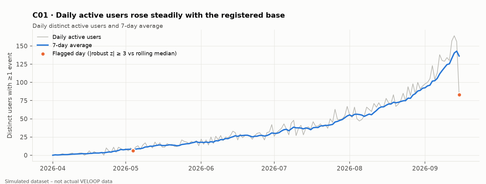

| Field | Value |
|---|---|
| Business question | How has daily activity evolved; are there unusual days? |
| Dataset | 03_Feature_Events |
| Fields used | user_id, event_datetime |
| Calculation | Distinct users per calendar day; 7-day trailing mean; robust z of log DAU vs 15-day rolling median |
| Filter | Clean events |
| Population | All active users |
| Time period | 2026-04-01 – 2026-09-15 |
| Interpretation | DAU peaked at 164 (2026-09-13); DAU tracks the cumulative registered base (ρ=0.987). Spikes are statistical flags only. |
| Limitation | No campaign/release calendar; spikes are not attributed to causes. |
| Product relevance | Capacity planning and anomaly monitoring. |

## C02 — Session Frequency Distribution

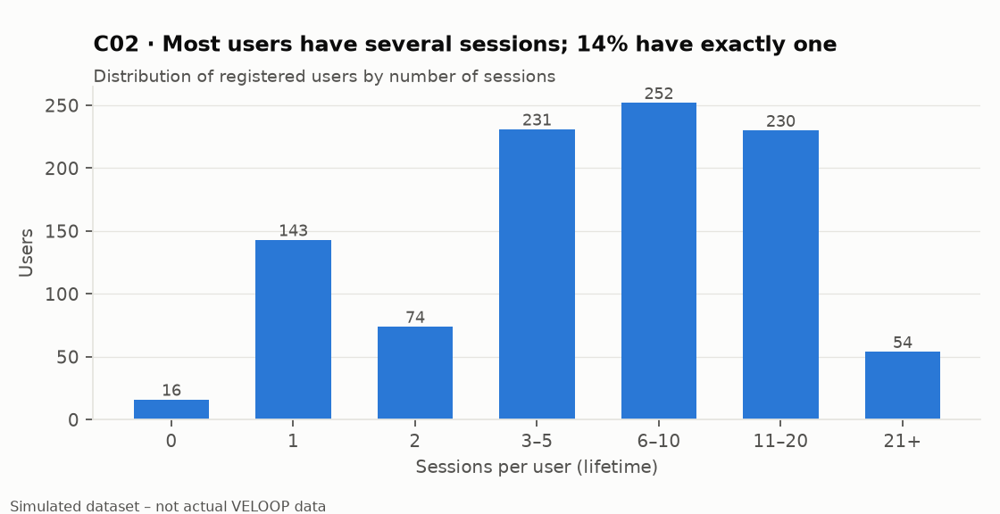

| Field | Value |
|---|---|
| Business question | How often do users return to open sessions? |
| Dataset | 02_Sessions |
| Fields used | session_id, user_id |
| Calculation | Count of sessions per user, binned |
| Filter | No filter (all records) |
| Population | All 1,000 registered users |
| Time period | 2026-04-01 – 2026-09-15 |
| Interpretation | 143 users have one session; median 6 sessions per active user. |
| Limitation | Lifetime counts are tenure-dependent. |
| Product relevance | Sizing re-engagement audiences. |

## C03 — Session Duration Distribution

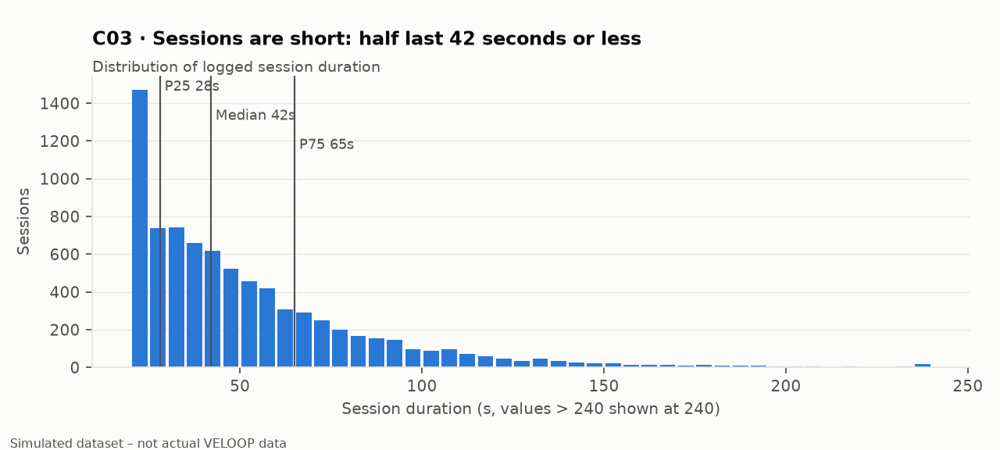

| Field | Value |
|---|---|
| Business question | How long do sessions typically last? |
| Dataset | 02_Sessions |
| Fields used | session_duration_seconds |
| Calculation | Histogram (5s bins), quartile markers |
| Filter | No filter (all records) |
| Population | All 7,913 sessions |
| Time period | 2026-04-01 – 2026-09-15 |
| Interpretation | Median 42s, P90 94s; duration is unrelated to depth (ρ=0.027). |
| Limitation | Session windows end before task completions (DQ-022). |
| Product relevance | Do not use duration as an engagement KPI. |

## C04 — Activation Funnel

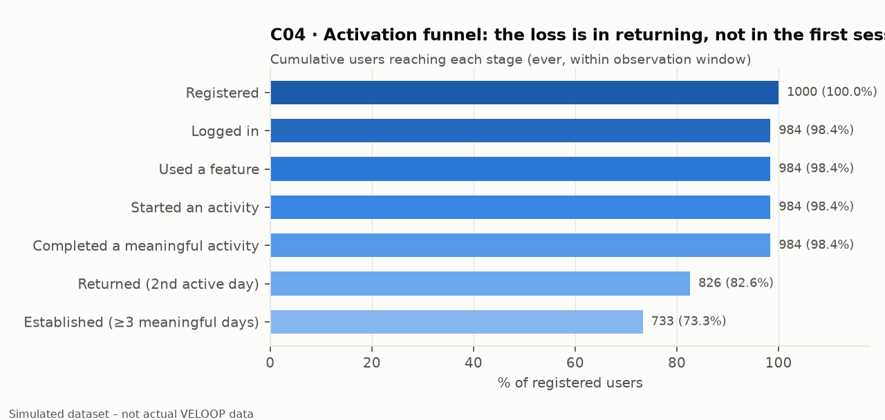

| Field | Value |
|---|---|
| Business question | What happens after a user joins? |
| Dataset | 01, 02, 03, 05 |
| Fields used | user_id, session_id, event stage, task_status |
| Calculation | Cumulative user counts per stage / registered users |
| Filter | Stage rules per activation_funnel.csv |
| Population | 1,000 registered users |
| Time period | 2026-04-01 – 2026-09-15 |
| Interpretation | Nearly all users with a session complete an activity; the first major loss is the second active day. |
| Limitation | Login proxied by sessions; completions not linked to starts. |
| Product relevance | Focus activation work on return and first-session delay. |

## C05 — Feature Adoption Comparison

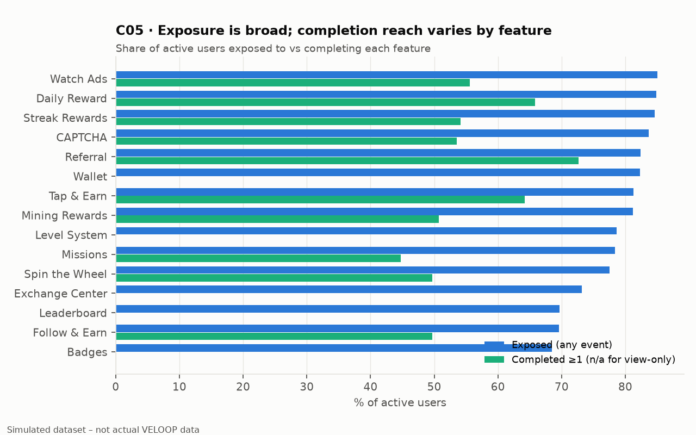

| Field | Value |
|---|---|
| Business question | Which features reach the most users, and how many complete them? |
| Dataset | 03_Feature_Events |
| Fields used | feature_name, event_name, user_id |
| Calculation | Users with any event / active users; users with ≥1 'complete' event / active users |
| Filter | Wallet, Exchange Center, Leaderboard have no completion events |
| Population | 984 active users |
| Time period | 2026-04-01 – 2026-09-15 |
| Interpretation | Exposure ranges 68.5–85.0% of active users. |
| Limitation | Exposure only known when a feature logs events. |
| Product relevance | Feature prioritisation and discovery work. |

## C06 — Feature Repeat-Use Comparison

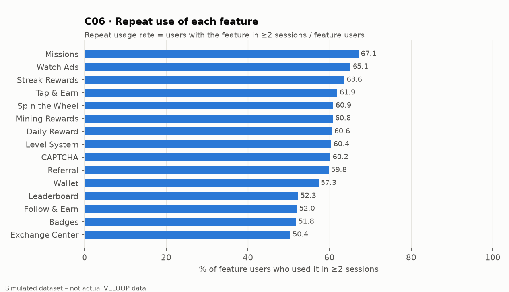

| Field | Value |
|---|---|
| Business question | Which features do users come back to? |
| Dataset | 03_Feature_Events |
| Fields used | feature_name, session_id, user_id |
| Calculation | Users with feature in ≥2 sessions / feature users |
| Filter | No filter (all records) |
| Population | Feature users |
| Time period | 2026-04-01 – 2026-09-15 |
| Interpretation | Repeat rates range 50.4–67.1%. |
| Limitation | Heavier users have more chances to repeat any feature. |
| Product relevance | Identify sticky vs one-off features. |

## C07 — User Engagement Segments

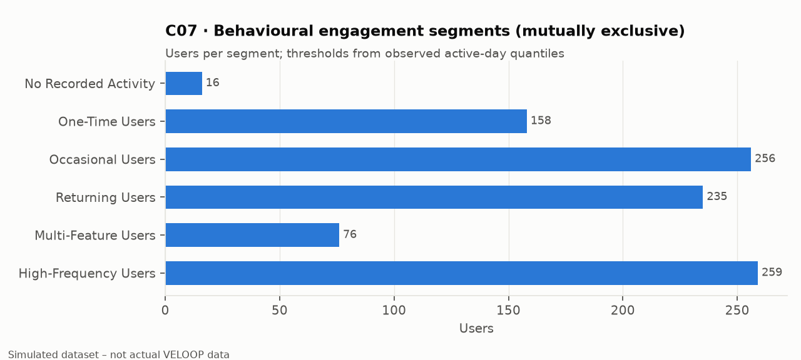

| Field | Value |
|---|---|
| Business question | What behavioural groups exist and how big are they? |
| Dataset | Derived users table |
| Fields used | n_active_days, n_features_completed |
| Calculation | Hierarchical rules (engagement_segments.csv) |
| Filter | No filter (all records) |
| Population | 1,000 users |
| Time period | 2026-04-01 – 2026-09-15 |
| Interpretation | No Recorded Activity 16; One-Time Users 158; Occasional Users 256; Returning Users 235; Multi-Feature Users 76; High-Frequency Users 259 |
| Limitation | Thresholds are quantiles of this dataset. |
| Product relevance | Targeting and sizing. |

## C08 — Acquisition Source Behaviour Comparison

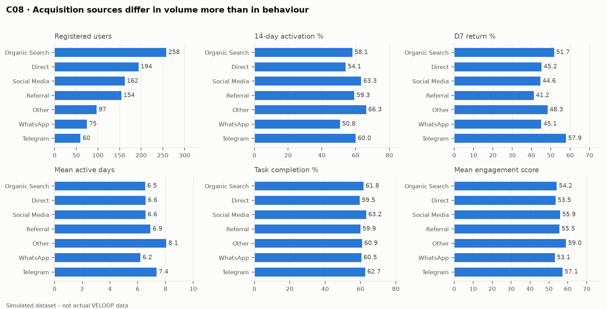

| Field | Value |
|---|---|
| Business question | Do behavioural patterns differ by acquisition source? |
| Dataset | Users + sessions + events + tasks |
| Fields used | acquisition_source, activation, D7 flags, active days, task_status, engagement score |
| Calculation | Per-group rates; Kruskal-Wallis / χ² tests |
| Filter | Activation/D7 use eligible users only |
| Population | 1,000 users |
| Time period | 2026-04-01 – 2026-09-15 |
| Interpretation | 0 of 10 tests show a non-trivial effect. |
| Limitation | Simulated sources/devices; all platform = Web. |
| Product relevance | Avoid ranking by registration volume alone. |

## C09 — Device Behaviour Comparison

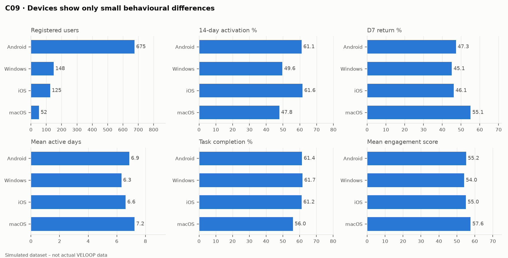

| Field | Value |
|---|---|
| Business question | Do behavioural patterns differ by device? |
| Dataset | Users + sessions + events + tasks |
| Fields used | device, activation, D7 flags, active days, task_status, engagement score |
| Calculation | Per-group rates; Kruskal-Wallis / χ² tests |
| Filter | Activation/D7 use eligible users only |
| Population | 1,000 users |
| Time period | 2026-04-01 – 2026-09-15 |
| Interpretation | 0 of 10 tests show a non-trivial effect. |
| Limitation | Simulated sources/devices; all platform = Web. |
| Product relevance | Avoid ranking by registration volume alone. |

## C10 — Retention / Cohort Chart

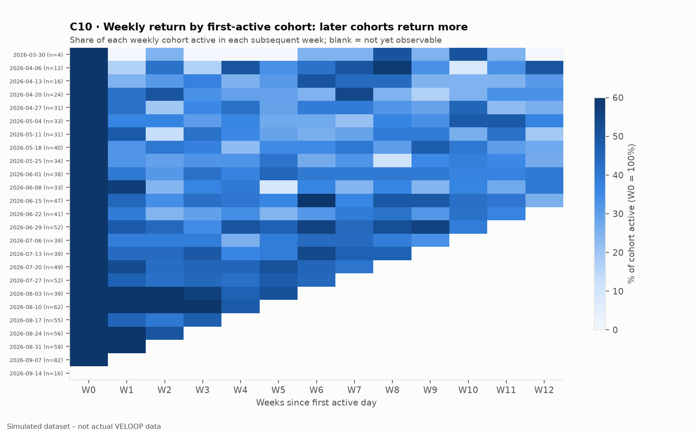

| Field | Value |
|---|---|
| Business question | Which cohorts return more frequently? |
| Dataset | 03_Feature_Events |
| Fields used | user_id, event date, first active date |
| Calculation | Distinct active users per cohort-week / cohort size |
| Filter | Unobservable cells blanked |
| Population | 984 active users |
| Time period | 2026-04-01 – 2026-09-15 |
| Interpretation | D7 47.3%, D30 41.8%; return rises for later cohorts (calendar effect). |
| Limitation | Right-censoring; small early cohorts. |
| Product relevance | Retention monitoring; control for cohort period. |

## C11 — Feature Journey Visualization

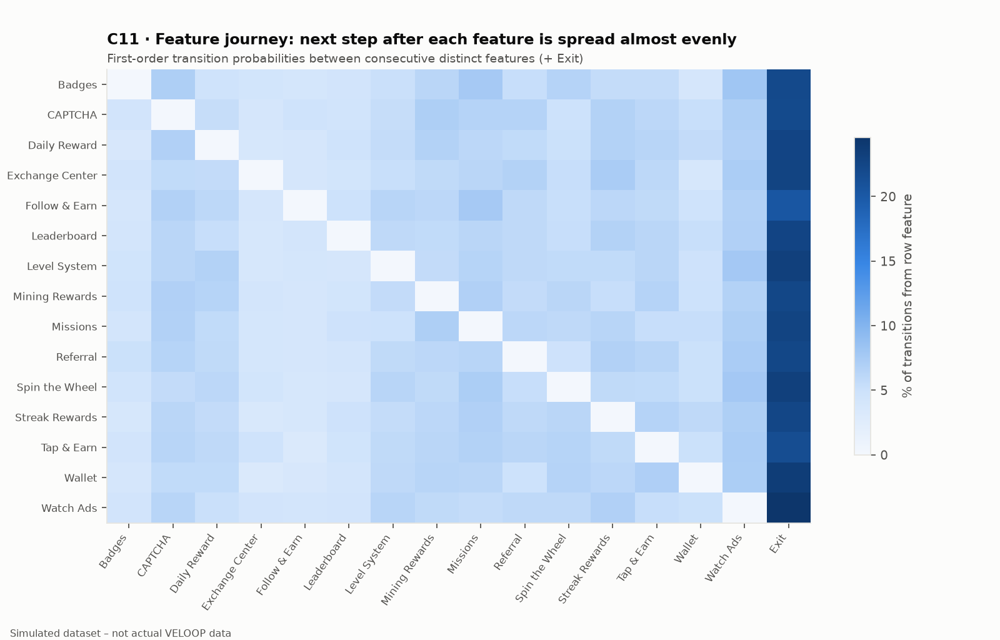

| Field | Value |
|---|---|
| Business question | What does a user's activity journey look like? |
| Dataset | 03_Feature_Events |
| Fields used | session_id, feature_name, event_datetime |
| Calculation | Collapsed consecutive features; row-normalised transition counts |
| Filter | Valid sessions |
| Population | 7,611 sessions |
| Time period | 2026-04-01 – 2026-09-15 |
| Interpretation | Lifts 0.79–1.27: no dominant path; Exit is a frequent next step. |
| Limitation | In-session order unreliable (DQ-033/034); no causal reading. |
| Product relevance | Journey-based recommendation needs better ordering data. |

## C12 — Drop-Off Visualization

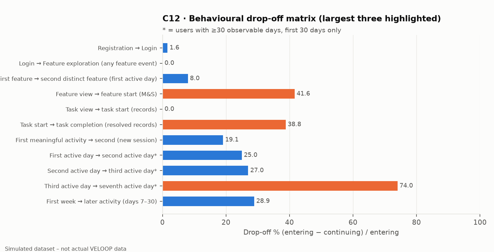

| Field | Value |
|---|---|
| Business question | Where do users stop progressing? |
| Dataset | 01, 02, 03, 05 |
| Fields used | Stage-specific (dropoff_matrix.csv) |
| Calculation | (entering − continuing) / entering |
| Filter | Stage-specific |
| Population | Varies by stage |
| Time period | 2026-04-01 – 2026-09-15 |
| Interpretation | Largest: Third active day → seventh active day (first 30 days), Feature view → feature start (user×feature, Missions & Spin), Task start → task completion (resolved records). |
| Limitation | Mixed units (users, records, user×feature). |
| Product relevance | Prioritise investigation areas. |

## C13 — Time-of-Day Activity

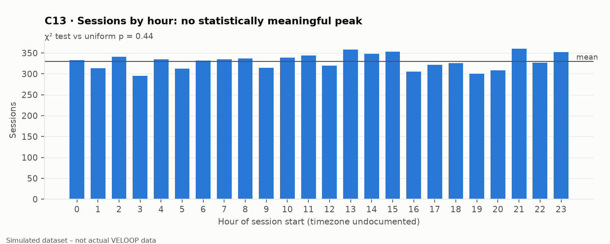

| Field | Value |
|---|---|
| Business question | When are users most active? |
| Dataset | 02_Sessions |
| Fields used | session_start hour |
| Calculation | Sessions per hour; χ² uniformity test |
| Filter | No filter (all records) |
| Population | All sessions |
| Time period | 2026-04-01 – 2026-09-15 |
| Interpretation | Busiest hours [21, 13, 15], quietest [3, 19, 16], but differences are within random variation. |
| Limitation | Timezone unknown. |
| Product relevance | No evidence for time-targeted notifications from this data. |

## C14 — Behavioural Anomaly Chart

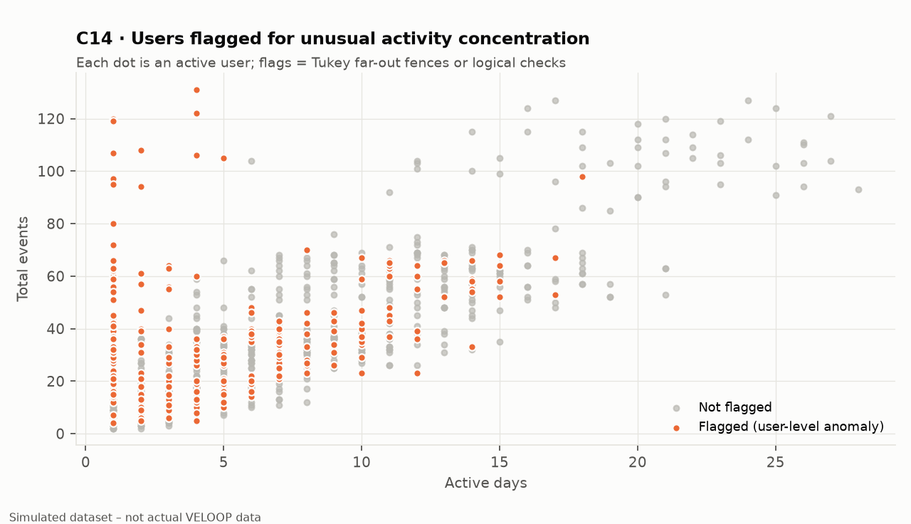

| Field | Value |
|---|---|
| Business question | Which users behave unusually? |
| Dataset | Derived users + anomaly register |
| Fields used | n_events, n_active_days, anomaly flags |
| Calculation | Tukey Q3+3·IQR fences; streak logic check |
| Filter | Active users |
| Population | 984 active users |
| Time period | 2026-04-01 – 2026-09-15 |
| Interpretation | 275 users flagged; mostly bursty activity on few days. Not a fraud determination. |
| Limitation | Generic statistical thresholds only. |
| Product relevance | Operations review queue. |

## C15 — Task Outcome by Category

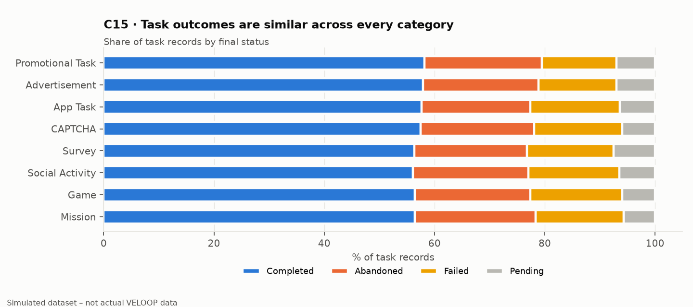

| Field | Value |
|---|---|
| Business question | Where does task friction concentrate? |
| Dataset | 05_Task_Activity |
| Fields used | task_category, task_status |
| Calculation | Status share of records |
| Filter | No filter (all records) |
| Population | 9,846 task records |
| Time period | 2026-04-01 – 2026-09-15 |
| Interpretation | Completion (resolved) 59.8–62.5% across categories. |
| Limitation | Coarse failure reasons. |
| Product relevance | Task UX prioritisation. |

## C16 — Calendar-Period Effect on Return

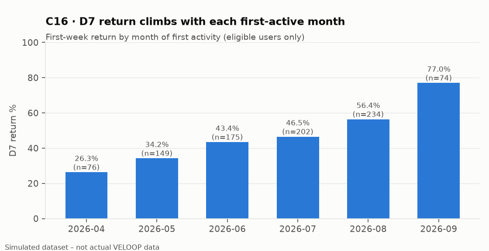

| Field | Value |
|---|---|
| Business question | Is return behaviour stable over time? |
| Dataset | 03_Feature_Events |
| Fields used | first active date, event dates |
| Calculation | D7 returned / D7 eligible per first-active month |
| Filter | D7-eligible users |
| Population | 910 users |
| Time period | 2026-04-01 – 2026-09-15 |
| Interpretation | Return rises strongly with calendar time – a confounder for every cohort comparison. |
| Limitation | Cause unknown (TO BE VERIFIED). |
| Product relevance | Stratify analyses by cohort period. |

## C17 — Engagement Score Distribution

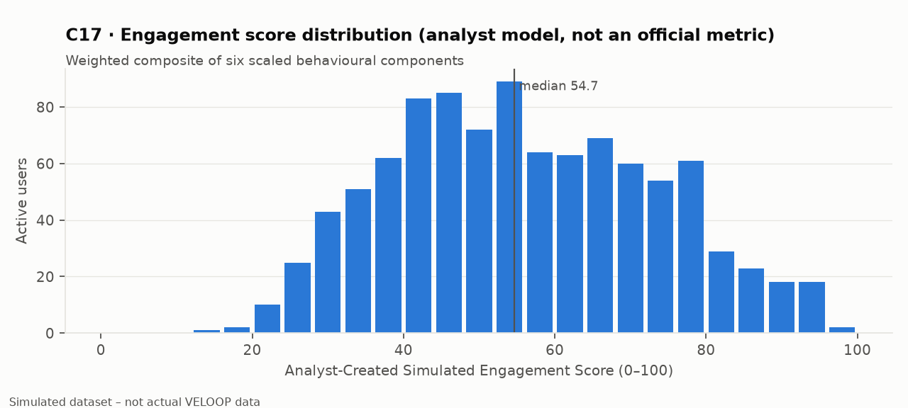

| Field | Value |
|---|---|
| Business question | How is engagement depth distributed? |
| Dataset | Derived users table |
| Fields used | 6 score components |
| Calculation | Weighted sum ×100 (engagement_score_components.csv) |
| Filter | Active users |
| Population | 984 active users |
| Time period | 2026-04-01 – 2026-09-15 |
| Interpretation | Median 54.7; range 14.5–96.8. |
| Limitation | Analyst weights; tenure bias. |
| Product relevance | Prioritisation of engagement cohorts. |

## C18 — Data Quality Impact

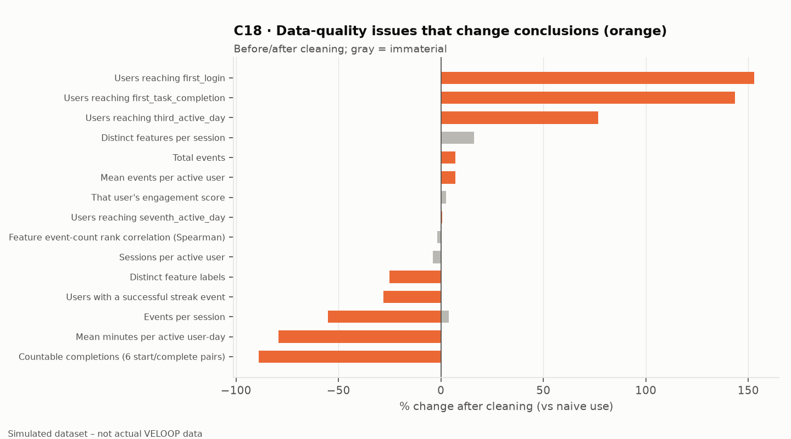

| Field | Value |
|---|---|
| Business question | Do data-quality problems change the conclusions? |
| Dataset | All sheets |
| Fields used | See data_quality_impact.csv |
| Calculation | (after − before) / before |
| Filter | /change/ > 0.5% |
| Population | Metric-specific |
| Time period | 2026-04-01 – 2026-09-15 |
| Interpretation | Session counters, milestone sheet, daily duration and strict sequence logic change conclusions; duplicates do not. |
| Limitation | Simulated stress tests are illustrative. |
| Product relevance | Engineering reconciliation priorities. |
